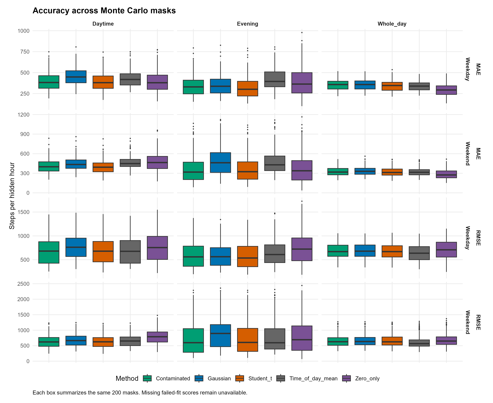
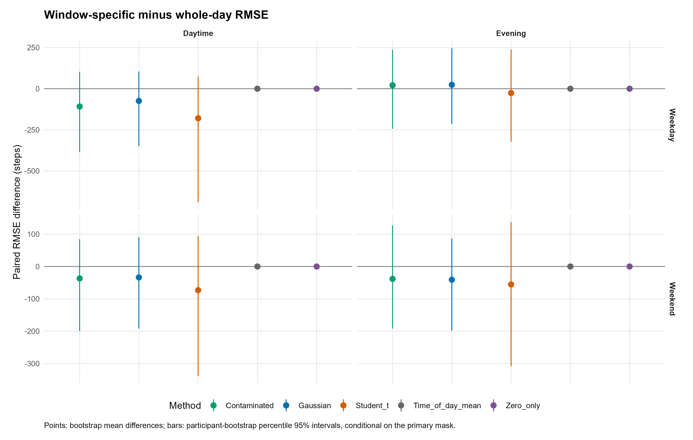

# Wearable Activity Imputation

**Do robust EM models recover missing hourly activity better than simple benchmarks?**

A statistical computing project comparing Gaussian EM, contaminated Gaussian ECM,
and Student's t EM with hourly-mean and zero-only imputation. The study evaluates
both prediction accuracy and the uncertainty behind an apparent improvement.

**R · EM/ECM · missing data · Monte Carlo simulation · cluster bootstrap · interactive reporting**



## The question

Hourly step counts are difficult to model: many observations are zero, while a few
contain large bursts of activity. Heavy-tailed distributions might handle those
bursts better than a Gaussian model. Fitting only daytime or evening hours might
also reduce estimation difficulty—but it removes information from other hours.

This project tests both ideas against simple alternatives using identical hidden
observations. It asks whether extra model complexity earns its place.

## Main findings

- **The hourly mean had the lowest whole-day mean RMSE on both dates:** 639.0
  steps on Friday and 614.9 on Sunday.
- Robust models sometimes improved substantially over Gaussian EM. Contaminated
  Gaussian reduced Friday daytime RMSE by **11.2%** and Sunday evening RMSE by
  **18.9%**, using the same fitting and evaluation windows.
- Whole-day improvements over Gaussian EM were much smaller: **0.5–1.7%** for
  contaminated Gaussian and **0.6–0.8%** for Student's t.
- Zero-only had the lowest whole-day MAE on both dates, demonstrating why zeros
  and positive activity must be evaluated separately.
- All 12 participant-bootstrap RMSE intervals for EM fitting-window differences
  included zero. The study does **not** establish a consistent population benefit
  from narrower windows or a universally best distribution.

| Date | Fitting window | Gaussian RMSE | Student's t RMSE | Contaminated RMSE |
|---|---|---:|---:|---:|
| Friday | Whole day | 686.7 | 681.0 | 683.0 |
| Friday | Daytime | 780.9 | 703.2 | 693.2 |
| Friday | Evening | 590.7 | 587.5 | 590.6 |
| Sunday | Whole day | 668.2 | 664.2 | 656.9 |
| Sunday | Daytime | 672.0 | 631.2 | 633.7 |
| Sunday | Evening | 906.5 | 743.7 | 735.4 |

Values are mean replicate-level RMSE across 200 MCAR masks, in steps per hidden
hourly observation. These rows compare distributions **within** a fitting window;
cross-window effects use separate paired comparisons on identical target cells.
The percentile bootstrap conditions on one fixed mask. Numerical rankings are
exploratory, not evidence of universal superiority.

## Study design

| Component | Design |
|---|---|
| Data | April 1 and May 8, 2016; 33 and 27 participant rows |
| Participant linkage | 34 unique IDs across dates; linked cluster resampling |
| Measurements | 1,440 observed hourly counts; no original missing values |
| Artificial missingness | Fixed-size 10% MCAR, rounded up: 80 and 65 hidden cells |
| Repetitions | 200 masks per date; 500 linked participant bootstrap samples |
| Fitting windows | Whole day [00:00,24:00), daytime **[09:00,18:00)**, evening [18:00,24:00) |
| Diagnostic window | Nighttime [00:00,06:00); hours 06–08 remain whole-day only |
| Covariance | Shared standardized penalty, κ = 10 |
| Student's t | Fixed degrees of freedom ν = 5 |
| Computation | 12,600 attempted EM/ECM fits; all met convergence criteria |
| Validation | 31 algorithm checks and 15 full-study checks passed locally |

These are **artificially hidden step counts**, not observed device failures.
Legitimate zeros remain observations and are eligible to be masked. Heldout truth
never enters model fitting, initialization, scaling, or hourly means. Bootstrap
duplicates carry the same mask, preventing an observed duplicate from revealing
a hidden target. The optional nested bootstrap–masking experiment was not run.

## Read the research report

- [Download the self-contained interactive HTML](https://github.com/Justin-JAJA/Wearable-device-project/raw/refs/heads/main/report/EM_Activity_Research_Report.html)
  and open it in a browser. It includes filters, hoverable plots, searchable tables,
  model derivations, numerical diagnostics, and limitations.
- [Editable R Markdown](report/EM_Activity_Research_Report.Rmd)
- [Scientific figures: vector PDF and 320 dpi PNG](results/figures/)
- [Paired method comparisons](results/model_comparisons/paired_model_comparisons.csv)
- [Paired fitting-window comparisons](results/model_comparisons/window_comparisons.csv)
- [Original research specification](docs/research_specification.md)



## Reproduce the work

Use R 4.5.1 or a compatible R installation, Pandoc, and the package versions in
`renv.lock`. Package installation requires access to a CRAN mirror.

```r
install.packages("renv")  # only if needed
renv::restore()
```

**Rebuild the report from the included result tables and figures:**

```sh
Rscript render_report.R
```

**Recompute the study:** first follow [data setup](data/README.md), then run:

```sh
Rscript run_analysis.R prepare
Rscript qa/validate_algorithms.R
Rscript run_analysis.R pilot
Rscript run_analysis.R
Rscript qa/verify_study.R
Rscript render_report.R --refresh-figures
```

Edit `config.yml` to change seeds, repetitions, windows, or numerical settings.
On Windows, `run_parallel.ps1` runs independent Rscript workers. Completed
repetitions are checkpointed and reused. Changed inputs or model code require
archiving old checkpoints before a new run.

The Gaussian and Student's t methods maximize a **penalized** EM objective; the
contaminated Gaussian uses **penalized ECM**. They are not labeled unpenalized
maximum-likelihood algorithms. Covariance updates use conditional second moments,
and the robust models include both latent scales/memberships and missing values.

## Repository contents and data handling

- `R/`: data preparation, masking, models, prediction, evaluation, simulations,
  bootstrap comparisons, and plotting.
- `report/`: editable scientific report, rendered HTML, CSS, and JavaScript.
- `results/`: aggregate summaries, all-activity Monte Carlo scores, diagnostics,
  published example trajectories, and figures.
- `qa/`: executable algorithm and full-study audits, plus saved passed checks.
- `docs/`: research specification and publication notes.

Raw workbooks, individual mask coordinates, full individual predictions, processed
activity matrices, and simulation checkpoints are **not distributed**. Example
participant labels are publication pseudonyms, and the source-ID mapping is not
included. The GitHub copy retains only all-activity replicate scores; a full rerun
also produces activity-subgroup scores and participant-level audit outputs.

## Interpretation and limitations

The two dates cannot establish typical weekday/weekend or holiday effects.
The participant sample is small. Results depend on the prespecified penalty,
t degrees of freedom, contamination constraints, and initialization. Continuous
models do not explicitly represent a point mass at zero; future work could test
a hurdle or count model. Bootstrap intervals describe participant resampling on
these dates under one fixed validation mask, not prediction for unseen people.

Source data: Furberg, Brinton, Keating, and Ortiz (2016),
[Crowd-sourced Fitbit datasets](https://zenodo.org/records/53894),
DOI [10.5281/zenodo.53894](https://doi.org/10.5281/zenodo.53894).
See the report for EM/ECM methodology references. This repository does not grant
new rights to source data or bundled third-party report dependencies.

Computational development, documentation, and analysis were assisted by OpenAI
Codex. The methods, completed-run outputs, and explicit limitations are supplied
for inspection and reproduction.
